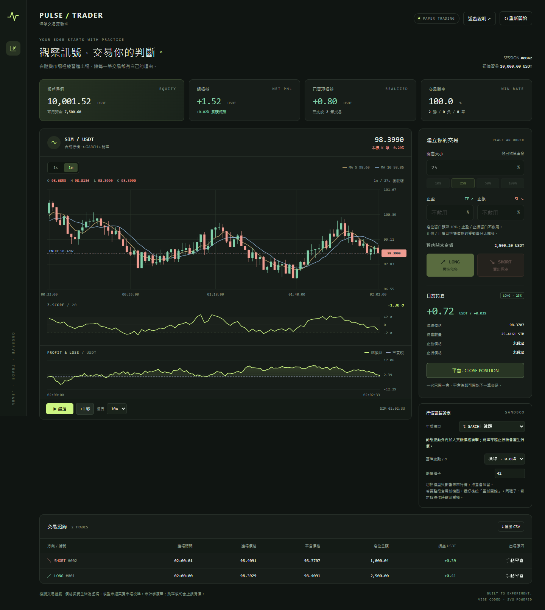

# PULSE TRADER｜短線交易實驗室

**[開始遊戲](https://jim20020317-lab.github.io/pulse-trader/)** · [完整規格](SPEC.md) · [作業繳交文字](SUBMISSION.md)

用四種合成行情練習 Long / Short 的互動網頁，所有畫面與邏輯均包含於 **index.html**。不需要安裝套件、連線交易所或啟動後端，直接用瀏覽器開啟即可。

## 操作

1. 開啟 `index.html`，選擇 1s 或 1m K 線。兩個週期使用相同的模擬行情。
2. 觀察 MA5、MA10 與下方 Z-score 20。最下方為本局 PnL 曲線。
3. 設定開倉大小、止盈、止損，按 LONG 或 SHORT。倉位留白為 10%；風險欄位留白即不啟用。
4. 一次只能持有一倉；按「平倉」退出，或等待止盈／止損觸發。
5. 可暫停、每次推進一秒、選擇 1×／10×／60× 速度，或匯出交易 CSV。
6. 在「市場設定」選擇價格模型。切換只影響未來行情，保留持倉與歷史；按「重新開始」才會依目前模型與種子重建全局行情。

| 價格模型 | 行情特徵 |
| --- | --- |
| 正態分布（預設） | 固定波動，適合熟悉操作 |
| Student’s t | 厚尾，極端漲跌比正態分布更常見 |
| t-GARCH | 厚尾加上波動叢聚，平靜與劇烈行情成群出現 |
| t-GARCH＋跳躍 | 額外加入偶發價格衝擊，跳過止損時會有滑價 |

初始資金為 10,000 USDT，無槓桿與手續費，預設基準 σ = 0.06%／秒。一般價格路徑的止盈、止損按門檻成交；跳躍模式穿越止損時按跳躍後價格成交，交易紀錄會標示，CSV 另列每單位價格滑價。跳躍止盈仍按設定門檻成交。

模型參數為教學設定，未經真實市場校準。相同種子、模型／波動設定及相同操作與切換時點可重播；種子在重新開始後套用。本局資料僅存在記憶體，重新整理頁面就會重置。

快捷鍵：空白鍵暫停／繼續，L 做多，S 做空，X 平倉。輸入欄位有焦點時不觸發快捷鍵。

## GitHub Pages 發布

1. 在 GitHub 建立一個公開儲存庫，例如 `pulse-trader`。
2. 將 **index.html** 上傳到儲存庫根目錄的 `main` 分支；只需要這一個檔案就能執行作品。
3. 開啟儲存庫 **Settings → Pages → Build and deployment**。
4. Source 選 **Deploy from a branch**，Branch 選 **main**，資料夾選 **/ (root)**，按 Save。
5. 等待 Pages 部署成功，在 Pages 頁面按 **Visit site**，實際開啟後再複製網址繳交。

依 [GitHub Pages 官方文件](https://docs.github.com/en/pages/getting-started-with-github-pages/creating-a-github-pages-site)，入口檔案須位於發布來源根目錄。此專案為單純靜態 HTML。

## 作業交付

- `index.html`：完整作品，CSS、JavaScript 與 SVG 均內嵌。
- `SPEC.md`：完整規格書。
- `SUBMISSION.md`：可貼到作業文字區的內容，請補上姓名等個資。
- `screenshot-desktop.png`、`screenshot-mobile.png`：實際瀏覽器畫面，含模擬交易範例。
- `engine-tests.cjs`：可使用 Node.js 執行的內嵌引擎驗證；網站本身不依賴此檔案。
- `model-tests.cjs`：驗證四種模型、重播、厚尾、波動叢聚與跳躍成交規則。

驗證：執行 `node engine-tests.cjs` 與 `node model-tests.cjs`，直接檢查 HTML 內嵌引擎。介面另經本機 Playwright 檢查四種模型切換、開平倉、CSV、無外部依賴及手機版；截圖由實際瀏覽器擷取。

本作品使用虛構行情與資金，僅供操作與學習。

